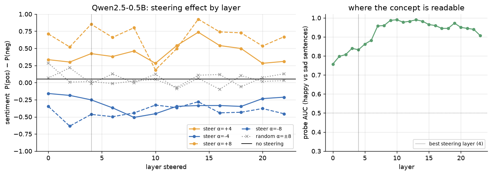
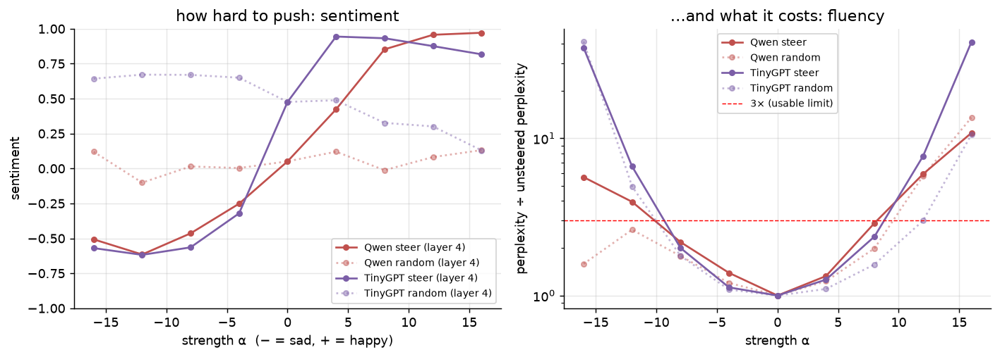
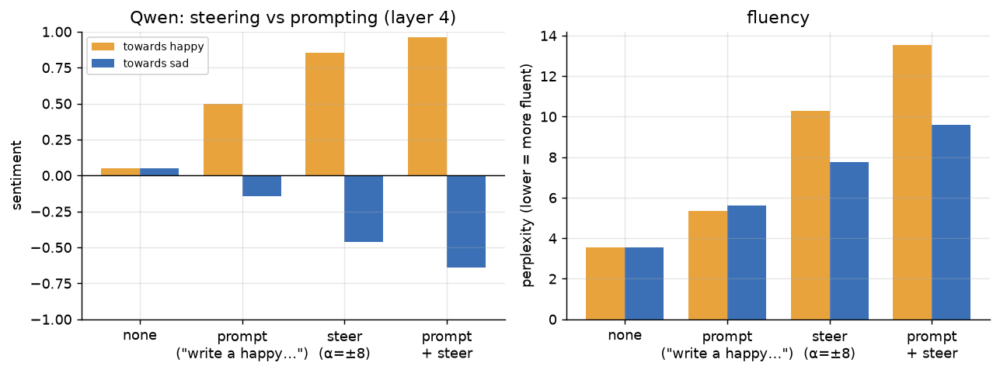
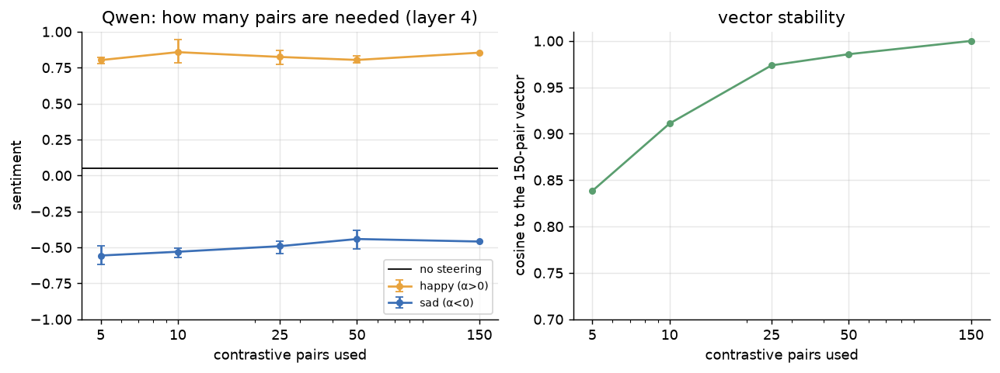
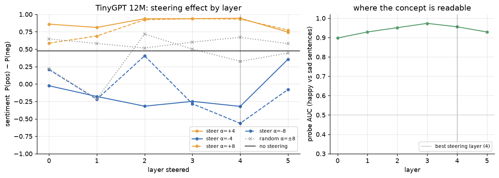
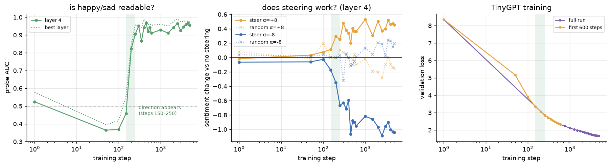

# Steering Transformers from the Inside

UMC301 Project 4 report (draft) · Archana Yadav · 21 Oct 2026

Project page: https://arcyadav-steering-transformers.static.hf.space

## Abstract

Adding a single "happy − sad" vector to a transformer's hidden states moves the sentiment of its text from +0.05 to +0.85 (Qwen2.5-0.5B, scale −1 to +1), while a random vector of the same length does nothing (−0.10 to +0.13 at the same layer). We build the vector from contrastive sentence pairs, add it to the residual stream with a PyTorch forward hook during generation, and never change the prompt or the weights.

We study this on two models: Qwen2.5-0.5B, and TinyGPT, a 12.2M-parameter GPT we wrote and trained from scratch on TinyStories in 18 minutes. Steering works on both, best at layer 4, and beats prompting (+0.85 vs +0.50 towards happy, −0.46 vs −0.14 towards sad) at a cost in fluency. Five pairs are enough to build a working vector. The concept is easiest to *read* in Qwen's middle layers (probe AUC 0.99 at layers 9–14) but easiest to *push* early (layer 4).

Because we own TinyGPT's training history, we can also ask when the concept appears. It does not grow gradually: until step 150 there is no happy/sad direction (probe AUC below 0.5) and steering does nothing; between steps 150 and 250 (about 3M tokens, 4% of training) the direction appears and steering starts to work. Everything is deployed as a project page with a replay of real generations and a live slider demo.

## 1. Introduction

We usually control a language model from the outside: we change the prompt, or we fine-tune the weights. Activation steering controls it from the inside. If a concept such as "happy" is stored as a direction in the model's hidden states, then adding that direction while the model writes should make the text happier, with no training and no change to the prompt.

This project builds that tool, measures honestly when it works and when it breaks, and applies it to a model whose whole training we control. It asks five questions:

1. **Does it work?** Does adding a "happy − sad" vector change sentiment more than a random vector of the same size? (E1)
2. **Where?** Which layer is the best place to steer, and is it the layer where the concept is easiest to read? (E1)
3. **How hard?** How does steering strength trade off against fluency? (E2)
4. **Steering or asking?** Is steering as strong as writing "a happy story" into the prompt? (E3) And how many example pairs does it need? (E4)
5. **Small model, and when?** Does steering work in a 12M-parameter model built from scratch (E5), and at which point in training does the happy/sad direction appear (E6)?

Qwen2.5-0.5B is the reliable, pretrained model for questions 1–4. TinyGPT is the original part: because we wrote and trained it, we can open every checkpoint and watch the concept form.

## 2. Background

**The residual stream.** A decoder-only transformer keeps one vector per token (896 numbers in Qwen2.5-0.5B, 384 in TinyGPT). Each block reads this vector, computes attention and a feed-forward update, and *adds* the result back: x ← x + attn(norm(x)), then x ← x + ffn(norm(x)). Elhage et al. (2021) call this running sum the residual stream. Because every block writes into the same space by addition, a vector added at one layer is carried forward to all later layers.

**Concepts as directions.** The linear representation hypothesis (Park et al., 2023) says many high-level concepts correspond to directions in this space. If so, the mean difference between hidden states of "happy" and "sad" text should point along the sentiment direction.

**Activation steering.** Turner et al. (2023, ActAdd) steered GPT-2 by adding the difference of two prompts' activations. Rimsky et al. (2024, Contrastive Activation Addition) averaged over many contrastive pairs and steered Llama 2 on behaviours such as sycophancy. Zou et al. (2023, Representation Engineering) read and controlled concepts with similar directions. This project uses the mean-difference (CAA-style) method, adds the random-vector control to every setting, and adds a question those papers could not ask: when, during training, the direction appears.

**Probes.** A probe tests whether a concept can be *read* from hidden states. Our probe is the steering direction itself: we project held-out sentences onto it and measure how well the projection separates positive from negative (ROC AUC).

## 3. Method

**Contrastive pairs.** Each pair differs only in the concept, e.g. "I loved the trip, it was wonderful" / "I hated the trip, it was awful". For Qwen, 10 word pairs (loved/hated, wonderful/awful, …) are placed in 15 templates: 150 pairs. For TinyGPT, 6 word pairs in 12 TinyStories-style templates ("Lily was very happy/sad because…"): 72 pairs. Separate sets are needed because TinyGPT only knows simple children's English.

**Steering vector.** For each layer ℓ, we run all positive and all negative texts through the model, take the residual stream after block ℓ, average over every token (skipping each text's first token, whose activations are unusually large), and subtract:

```
v_ℓ = mean over positive tokens of h_ℓ(t)  −  mean over negative tokens of h_ℓ(t)
```

**Steering.** During generation, a PyTorch forward hook on block ℓ replaces its output h with h + α·v, at every position and every new token. α > 0 pushes towards happy, α < 0 towards sad. The vector is used at its natural size (for Qwen layer 4, |v| ≈ 1.1), so α is a multiple of the real happy–sad gap. Weights and prompt are never changed, and the hook is removed afterwards.

**Random control.** Every steered setting is repeated with a random Gaussian vector rescaled to the same length as v, at the same layer and strength. This separates "the concept moves the text" from "any push of this size moves the text".

**Metrics.**

- *Sentiment:* P(positive) − P(negative) from the 3-class classifier `cardiffnlp/twitter-roberta-base-sentiment-latest`, in [−1, 1], averaged over all generations. A 2-class SST-2 classifier was tried first and rejected: it called neutral text negative ("The train leaves at 5 pm" → 63% negative), which hid steering towards sad.
- *Fluency:* perplexity of the continuation under the **unsteered** model (higher = less natural), plus *distinct-2*, the share of unique word bigrams, because repetitive loops can have deceptively low perplexity.
- *Probe AUC:* project 20 + 20 naturally written positive and negative sentences that use none of the pair words ("My dog died yesterday") onto v_ℓ and compute ROC AUC; 0.5 = chance, 1.0 = perfect. A first probe on held-out template pairs was rejected because they differ by one word, so every layer, even layer 0, scored 1.0.
- *Best setting:* the (layer, α) with the largest sentiment(+α) − sentiment(−α) among settings whose perplexity stays below 3× the unsteered perplexity.

## 4. Models

| | Qwen2.5-0.5B (base) | TinyGPT (ours) |
| --- | --- | --- |
| Parameters | 494M | 12.2M (12,194,688) |
| Layers / width / heads | 24 / 896 / 14 (GQA) | 6 / 384 / 6 |
| Context | 32k | 256 tokens |
| Tokenizer | Qwen BPE, 151k vocab | our byte-level BPE, 4,096 vocab |
| Training | pretrained by Alibaba | from scratch: 80M TinyStories tokens, 18 min on one T4 |
| Role | main experiments E1–E4 | E5 (steering) and E6 (training history) |

**TinyGPT** (`tinygpt/model.py`) is written from scratch in PyTorch. Each component is a deliberate, modern choice:

| Component | What it does | Why |
| --- | --- | --- |
| BPE tokenizer, vocab 4,096 | trained on TinyStories | GPT-2's 50k vocabulary would put about 19M parameters in the embedding alone |
| RoPE | rotates query and key vectors by a position-dependent angle | attention then depends on relative distance |
| RMSNorm | rescales each vector to unit root-mean-square | simpler than LayerNorm, same quality |
| Pre-norm | x + f(norm(x)) | keeps a clean residual path; stable training |
| SwiGLU feed-forward, hidden 1,024 | gated MLP | standard in modern LLMs; same parameter count as a 4× GELU MLP |
| Causal self-attention, 6 heads | each token attends to earlier tokens | standard; uses PyTorch's fused attention |
| Tied embeddings | output layer = input embedding matrix | saves 1.6M parameters |
| Residual stream | every block adds its output to a running vector | the vector that steering edits |

The model also supports learned, sinusoidal, ALiBi or no positional encoding, LayerNorm, post-norm, GELU, and grouped-query or multi-query attention. These switches are covered by 52 unit tests (exact parameter count, causality, fused vs explicit attention, longer-than-training contexts, overfitting a batch) but were not used in the final run.

**Training.** 500k TinyStories (115M tokens) were tokenized; one run used 80M of them: 4,882 steps of 64 × 256 tokens, AdamW (lr 1e-3, betas 0.9/0.95, weight decay 0.1), 200 warm-up steps then cosine decay to 10%, gradient clipping 1.0, fp16 mixed precision, about 86k tokens/s on a Kaggle T4. Final validation loss is 1.67 (perplexity 5.3), and samples are coherent stories ("Lily … went to the park to play with her friends … saw a pretty butterfly"). A checkpoint was saved every 500 steps. For E6 the first 600 steps were re-run with the same seed and the same learning-rate schedule, saving every 50 steps; the re-run reproduced the original validation losses (2.861 at step 250, 2.412 at step 500).

## 5. Experimental setup

Every setting generates 40 new tokens per prompt with temperature 0.7 and top-p 0.9, two samples per prompt (seeds 0 and 1). Qwen uses 50 neutral prompts ("I went to the market today and"); TinyGPT uses 30 story openings ("Tom had a red ball. He"). So each Qwen number averages 100 texts and each TinyGPT number 60. Unsteered baselines use the same prompts and seeds.

| # | Question | Model | Settings |
| --- | --- | --- | --- |
| E1 | Which layer? | Qwen | every 2nd layer (0–22) × α ∈ {±4, ±8} × {steer, random} + probe AUC at all 24 layers |
| E2 | How hard? | Qwen | best layer × α ∈ {±4, ±8, ±12, ±16} × {steer, random} |
| E3 | Steering vs prompting | Qwen | none / prompt / steer / prompt + steer, towards happy and towards sad |
| E4 | How many pairs? | Qwen | vectors from 5, 10, 25, 50 pairs (3 random subsets each) and all 150 |
| E5 | Small model | TinyGPT | all 6 layers × α ∈ {±2, ±4, ±8, ±16, ±32}, then E2 at its best layer |
| E6 | When does it appear? | TinyGPT | 22 checkpoints (every 50 steps to 600, then every 500): probe AUC + steering at α = ±8 |

In E3, "asking" means starting the prompt with "The following is a happy, cheerful story full of joy." (or the sad version), since Qwen2.5-0.5B is a base model and does not follow instructions. Fluency in E3 is always measured on the plain prompt. The layer and strength for E2–E4 and E6 were chosen automatically from E1 (section 3).

**Compute.** Everything ran on free Kaggle T4 GPUs: one session for data, TinyGPT training and all experiments, and a second, shorter session for the dense early checkpoints, about 2 GPU-hours in total. Development and the demo run on a laptop CPU.

## 6. Results

Steering works on both models, with the best two-way setting at layer 4, α = ±8 for each, and random vectors of the same size have no consistent effect. Sentiment runs from −1 (sad) to +1 (happy).

### E1: Which layer? (Qwen)



Unsteered Qwen scores +0.05. At every layer, the concept vector moves sentiment in the chosen direction and the random vector stays between −0.10 and +0.29. The best layer by the two-way criterion is layer 4: +0.85 at α = +8 and −0.46 at α = −8 (perplexity 10.3 vs 3.6 unsteered). Layer 14 gives the strongest single push towards happy (+0.93) but a weaker push towards sad (−0.28).

The probe tells a different story: AUC rises from 0.76 at layer 0 to 0.99 at layers 9–14 and ends at 0.91. **The concept is most readable in the middle of the network but most steerable early.**

### E2: How hard to push?



Sentiment follows an S-curve with α. Towards happy, Qwen saturates at +0.96–0.97 for α = 12–16, but perplexity rises to 21 and 38. Towards sad, the effect peaks at α = −12 (−0.62) and *weakens* at −16 (−0.51) as text breaks into loops ("I looked at the world, I looked at the world…"). Both models cross 3× the unsteered perplexity between |α| = 8 and 12, which marks the usable range.

### E3: Steering vs prompting (Qwen, layer 4, α = ±8)



| Towards | Nothing | Prompt | Steer | Prompt + steer |
| --- | --- | --- | --- | --- |
| happy | +0.05 | +0.50 | +0.85 | +0.96 |
| sad | +0.05 | −0.14 | −0.46 | −0.64 |
| perplexity (happy / sad) | 3.6 | 5.4 / 5.6 | 10.3 / 7.8 | 13.5 / 9.6 |

Steering moves sentiment about twice as far as asking, and the two add up. Asking keeps the text more fluent.

### E4: How many pairs are needed? (Qwen)



Five pairs already give +0.80 / −0.56 on average across three random subsets, as strong as all 150 pairs (+0.85 / −0.46). The vector itself settles more slowly: its cosine similarity to the 150-pair vector is 0.84 with 5 pairs, 0.91 with 10 and 0.97 with 25. A rough direction is enough to steer.

### E5: Steering a 12M model built from scratch (TinyGPT)



TinyGPT has a clear happy/sad direction at every layer (probe AUC 0.90–0.97). Unsteered, it is already positive (+0.48), because TinyStories almost always end happily. At layer 4, α = +8 gives +0.93 and α = −8 gives −0.56, with perplexity 5.9 and 4.9 against 2.5 unsteered. From |α| = 16 the model breaks (perplexity above 90). A 12M model trained for 18 minutes is steerable in the same way as a 494M pretrained one, and at the same relative depth.

### E6: When does the direction appear during training?



| Step | Val loss | Probe AUC, layer 4 | Steer +8 (change) | Steer −8 (change) |
| --- | --- | --- | --- | --- |
| 0 | 8.35 | 0.52 | −0.02 | −0.07 |
| 100 | 3.90 | 0.37 | +0.08 | −0.03 |
| 150 | 3.35 | 0.46 | +0.11 | −0.17 |
| 200 | 3.07 | 0.82 | +0.29 | −0.35 |
| 250 | 2.86 | 0.91 | +0.25 | −0.67 |
| 500 | 2.41 | 0.92 | +0.41 | −0.88 |
| 4,881 (end) | 1.67 | 0.96 | +0.45 | −1.04 |

Changes are measured against the unsteered text at the same checkpoint. Until step 150 the direction does not exist: probe AUC is at or below chance and steering changes almost nothing. **Between steps 150 and 250 (about 2.5–4M tokens, 3–5% of training) the direction appears**, the probe jumps to 0.91 and steering starts to work. Steering towards happy is close to its final strength by step 300; steering towards sad keeps strengthening until about step 2,000. Random vectors stay within about ±0.35 of the unsteered text throughout, with no consistent direction.

## 7. Discussion

**Reading a concept is not the same as pushing it.** In Qwen the probe peaks in the middle layers (AUC 0.99 at 9–14), yet the best two-way steering is at layer 4. A plausible reason: a vector added early passes through 20 more blocks, which can turn "slightly happier hidden state" into happier word choices; a vector added late has little room left to act and must already be in the exact form the final layers expect. Middle and late layers still steer happy well (layer 14 reaches +0.93 at α = 8), but they push sad less (−0.28).

**Happy is easier than sad.** In both models, at the best layer and at most others, steering towards happy moved sentiment further than steering towards sad (the exception is Qwen layers 8–10, where the two are about equal). The training data probably contributes: TinyStories almost always end happily (unsteered TinyGPT is already +0.48), and the web text Qwen learned from leans positive in casual narration. Pushed hard towards sad, the models fall into loops ("I looked at the world, I looked at the world…") before they reach strongly negative text.

**What "sad" means depends on what the model has read.** Pushed towards sad, TinyGPT writes about loud, scary and mean things ("He thought loud loud so loud mean loud noises or scary…"), not grief. Its idea of the negative side was learned from children's stories, where conflict is a loud dog or a broken toy. The direction is real, but its meaning comes from the training data.

**Steering vs prompting.** Steering moved sentiment more than asking for a happy or sad story, and the two combine. Prompting kept text more fluent (perplexity 5.4 vs 10.3), so it remains the gentler tool; steering is stronger and needs no instruction-following ability, which matters for a base model.

**A concept appears suddenly in training.** In TinyGPT the happy/sad direction does not slowly sharpen: for 150 steps there is none, then within about 100 steps it becomes readable (AUC 0.46 → 0.91) and steerable. It appears when validation loss falls below about 3.1, after the model has learned which words are frequent but early in learning how sentences fit together. Our reading is that the model first learns word statistics and only then the higher-level features that sentiment depends on. One run, one seed, so this needs repeating before it is called general (section 8).

## 8. Limitations

- **One training run, one seed.** The sudden appearance of the direction in TinyGPT is seen in one run (re-run once with the same seed). Other seeds, model sizes and datasets could move or smooth the transition.
- **One concept.** Experiments use sentiment only. The demo also steers user-defined concepts (e.g. formal ↔ casual), but these were checked by eye, not measured.
- **Automatic sentiment scoring.** The classifier was trained on tweets and can misjudge odd or broken text; for that reason we also report fluency and read samples by hand. Steered text that loops can still score strongly positive or negative.
- **Small samples.** 100 texts per Qwen setting and 60 per TinyGPT setting give differences of about ±0.1 that are noise; we only draw conclusions from larger effects and from consistent patterns across layers.
- **Fluency cost.** Every effective setting raises perplexity (about 3× at the best setting); steering here is a research tool, not a polished generation method.
- **Probe.** Our probe uses the steering direction itself on 40 sentences; a trained logistic-regression probe on more data could read the concept at layers where ours does not.
- **Demo filter.** In the live demo, Qwen is stopped from writing Chinese characters and "____" blanks because the base model drifts into exam questions; the experiments used no such filter.

## 9. Deployment and reproducibility

The project is deployed in two parts, at no cost:

| Part | Where | What it offers |
| --- | --- | --- |
| Project page (always online) | [arcyadav-steering-transformers.static.hf.space](https://arcyadav-steering-transformers.static.hf.space) | headline findings, method, all figures, and an interactive replay of real generations from E1–E3 and E6 (choose model, prompt, layer, strength or training step) |
| Live demo (Gradio) | runs with `python app.py --share`; reachable on the local network and through a public gradio.live link that the project page picks up automatically | steer Qwen or TinyGPT with sliders, define your own concept from example sentences, and a concept meter that colours each token by its projection on the direction |
| Code and results | [github.com/arcyadav/tiny-gpt-and-qwen-steering-study](https://github.com/arcyadav/tiny-gpt-and-qwen-steering-study) | all code, Kaggle notebooks, result JSON files, every generated text, figures |

Hugging Face no longer hosts Gradio apps on free hardware, so the live demo runs on the author's laptop (Qwen about 6 s per generation on CPU) while the static page stays online permanently.

To reproduce: `kaggle/steer_experiments.ipynb` runs E1–E4 on Qwen; `kaggle/tinygpt_train_and_steer.ipynb` builds the data, trains TinyGPT and runs E5 and E6; `kaggle/tinygpt_early.ipynb` re-runs the first 600 steps for E6; `python plots.py` draws the figures; `pytest` runs the 52 model tests.

## 10. Conclusion

A single vector, built from a handful of sentence pairs and added to the residual stream, reliably steers the sentiment of both a pretrained 0.5B model and a 12M model we built ourselves, and a random vector of the same size does not. Steering is stronger than prompting but costs fluency, works best early in the network (layer 4) even though the concept is most readable in the middle, and is easier towards happy than towards sad. In our own model, the happy/sad direction appears abruptly, between training steps 150 and 250, about 4% of the way through training. The next steps would be more seeds and model sizes for the training result, more concepts, and a trained probe.

## References

1. Vaswani et al. *Attention Is All You Need.* NeurIPS 2017.
2. Elhage et al. *A Mathematical Framework for Transformer Circuits.* Anthropic, 2021.
3. Turner et al. *Activation Addition: Steering Language Models Without Optimization.* 2023.
4. Rimsky et al. *Steering Llama 2 via Contrastive Activation Addition.* ACL 2024.
5. Zou et al. *Representation Engineering: A Top-Down Approach to AI Transparency.* 2023.
6. Park, Choe and Veitch. *The Linear Representation Hypothesis and the Geometry of Large Language Models.* 2023.
7. Eldan and Li. *TinyStories: How Small Can Language Models Be and Still Speak Coherent English?* 2023.
8. Qwen Team. *Qwen2.5 Technical Report.* 2024.
9. Su et al. *RoFormer: Enhanced Transformer with Rotary Position Embedding.* 2021.
10. Zhang and Sennrich. *Root Mean Square Layer Normalization.* NeurIPS 2019.
11. Shazeer. *GLU Variants Improve Transformer.* 2020.
12. Loureiro et al. *TimeLMs: Diachronic Language Models from Twitter* (the cardiffnlp sentiment model). ACL 2022.

References are listed from memory and should be checked against the papers before submission.
